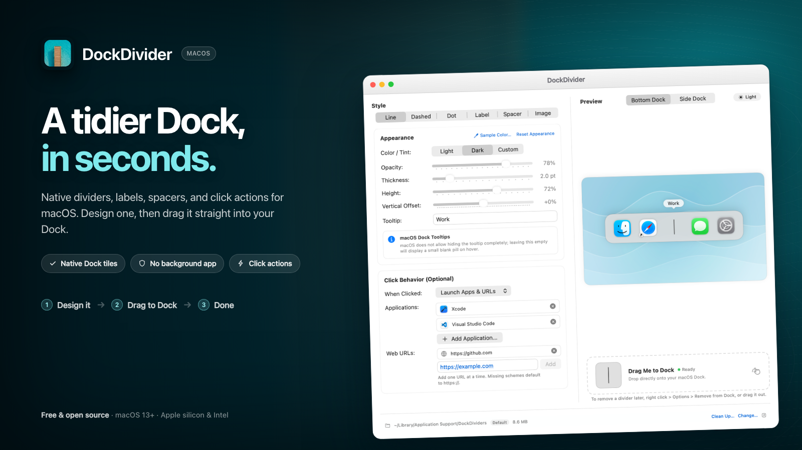
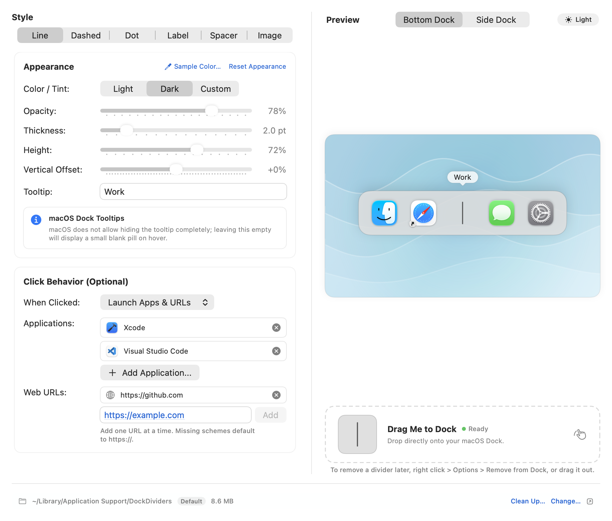
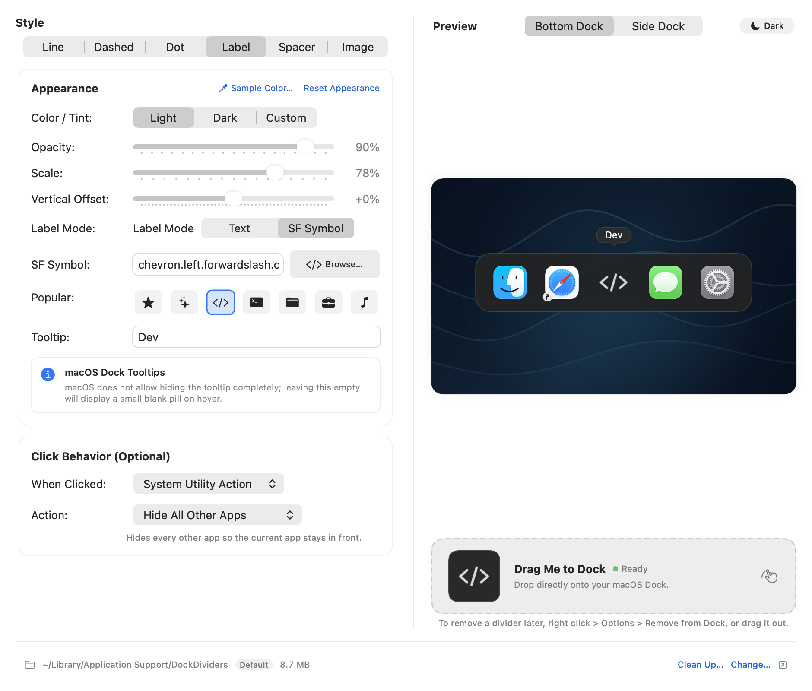
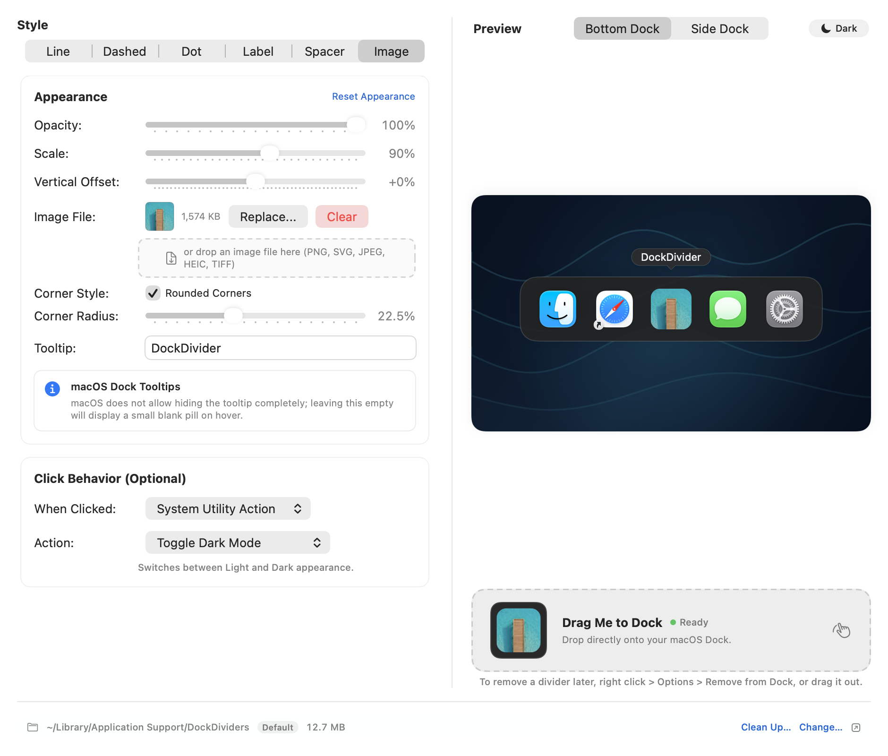
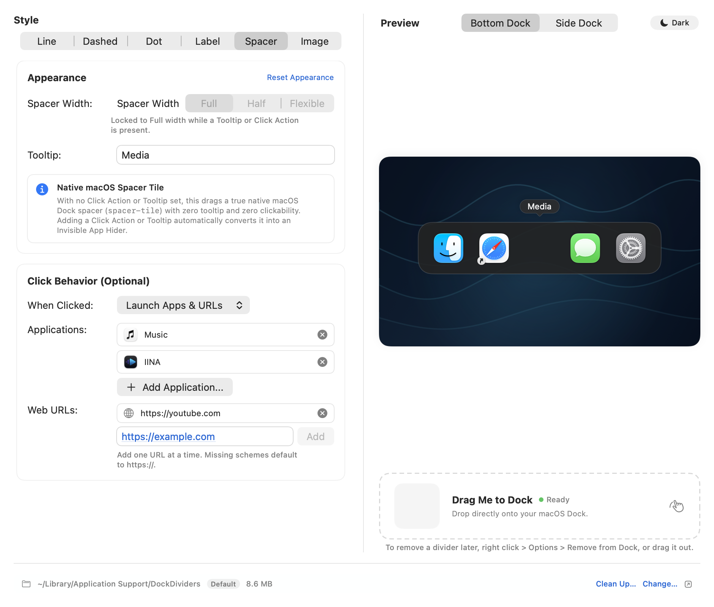
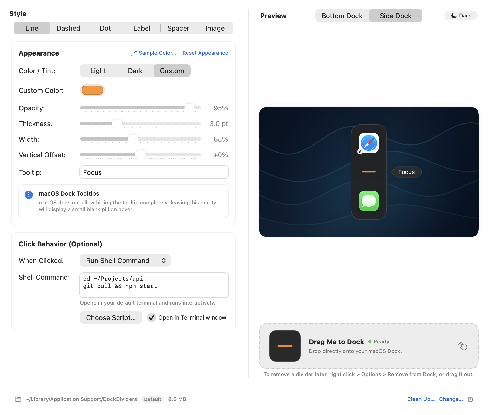
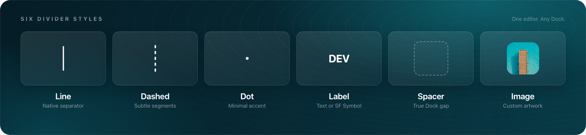

# DockDivider

A native macOS utility for creating visual dividers, labels, spacers, and
clickable action tiles that live directly in your Dock.

DockDivider generates self-contained `.app` bundles and native Dock spacer
files. Drag one from the app window into your Dock; there is no daemon, menu
bar agent, or background process left behind.

<p align="center">
  <a href="docs/images/cover.png">
    
  </a>
</p>


---

## Features

- **Divider styles**
  - **Line** — a native-style separator with configurable thickness, height,
    opacity, color, and orientation.
  - **Dashed** — a segmented separator whose dash count and spacing are
    derived from thickness, height, and opacity so every resolution matches.
  - **Dot** — a small centered circle.
  - **Label** — horizontal or vertical text, or an SF Symbol.
  - **Spacer** — true native Dock spacers (`.dockspace`, `.docksmallspace`,
    `.dockflexspace`) when no click action or tooltip is configured.
  - **Image** — PNG, JPEG, HEIC, TIFF, or SVG artwork with scale, offset,
    opacity, and corner-radius controls.
- **Live Dock preview** with light/dark glass and wallpaper context.
- **Dock-aware orientation** for bottom and side Docks.
- **Optional click actions**
  - Launch a set of apps and web URLs.
  - Run an Apple Shortcut.
  - Run a shell command or a chosen script, in the background or a terminal.
  - Built-in system actions such as Hide Others, Toggle Dark Mode, Empty Trash,
    Mission Control, and Activity Monitor.
- **Drag-to-Dock workflow** with revisioned background staging, so an edited
  divider is never dragged with stale content.
- **Draft persistence** in Application Support, separate from `UserDefaults`.
- **First-run onboarding** with a one-time welcome sheet.
- **Storage management** showing total disk usage and a confirmation-based
  cleanup sheet.
- **Accessibility** labels, keyboard-reachable drag fallback, and
  validation-before-drag for incomplete configurations.

> [!WARNING]
> **The tooltip cannot be hidden.** macOS shows a hover tooltip pill for every
> divider app bundle. Clearing the tooltip text does not remove the pill; it
> only makes it blank. Only a true native spacer (no click action or tooltip)
> avoids the tooltip entirely.

---

## Screenshots

### Design it, see it live

**Native-style lines.** Thickness, height, opacity, tint, and vertical offset,
previewed on a real Dock surface, with an optional app and URL launcher on click.

[](docs/images/screenshot-line.png)

### More than a divider

|  |  |
| :---: | :---: |
| [](docs/images/screenshot-label.png) | [](docs/images/screenshot-image.png) |
| **Labels and SF Symbols.** A monogram or any SF Symbol, with a native hover tooltip and a built-in system action. | **Custom artwork.** PNG, SVG, JPEG, HEIC, or TIFF with scale, offset, opacity, and corner-radius controls. |
| [](docs/images/screenshot-spacer.png) | [](docs/images/screenshot-side-dock.png) |
| **Spacers and invisible launchers.** A true native Dock gap, or an invisible app and URL launcher when a click action is attached. | **Bottom or side Docks.** Dock-aware orientation, custom tints, and click actions such as shell commands and Apple Shortcuts. |

### Divider styles

[](docs/images/styles.png)

---

## Requirements

- macOS 13.0 (Ventura) or later on Apple silicon or Intel
- Xcode 16.0 or later to build from source (the project uses
  filesystem-synchronized groups and the Swift 5 language mode)
- No third-party dependencies

Development and automated tests run on macOS 14, 15, and 27. macOS 13
Ventura is supported on a best-effort basis; include your macOS version if you
report an issue.

DockDivider is distributed directly, outside the Mac App Store. The app is not
sandboxed because it creates and repairs executable bundles in a folder you
choose, and it ad-hoc signs each generated bundle so the Dock can launch it.

---

## Install

1. Download the latest `DockDivider-x.y.z.dmg` from
   [GitHub Releases](https://github.com/jackbbb95/DockDivider/releases).
2. Open the DMG and drag **DockDivider** into **Applications**.
3. Launch it. Official release builds are signed with a Developer ID and
   notarized, so Gatekeeper allows the first launch without a bypass.

If you build the app yourself, it is unsigned and macOS may require confirming
it in **System Settings > Privacy & Security**. Actions that drive System
Events (Toggle Dark Mode, Toggle Mute) may ask for Automation permission the
first time; DockDivider does not need Accessibility or Full Disk Access.

---

## Building and running

```bash
git clone https://github.com/jackbbb95/DockDivider.git
cd DockDivider
open DockDivider.xcodeproj
```

Select the **DockDivider** scheme and **My Mac**, then press `Cmd+R`.
Run the test suite with `Cmd+U`, or from the command line:

```bash
DEVELOPER_DIR=/Applications/Xcode.app/Contents/Developer \
  xcodebuild -project DockDivider.xcodeproj \
  -scheme DockDivider \
  -configuration Debug \
  -destination 'platform=macOS' \
  -only-testing:DockDividerTests test \
  CODE_SIGNING_ALLOWED=NO
```

### Release build

Release builds use `ARCHS_STANDARD` (`arm64` + `x86_64`) and hardened runtime.
Use a generic destination: a `platform=macOS` destination builds only the host
architecture even in Release.

```bash
DEVELOPER_DIR=/Applications/Xcode.app/Contents/Developer \
  xcodebuild -project DockDivider.xcodeproj \
  -scheme DockDivider \
  -configuration Release \
  -destination 'generic/platform=macOS' \
  build
```

Both the app and its embedded `divider_runner` should be universal:

```bash
lipo -info …/DockDivider.app/Contents/MacOS/DockDivider
lipo -info …/DockDivider.app/Contents/Resources/divider_runner
```

Distribution signing and notarization need a Developer ID Application identity
and `notarytool` credentials, which are not part of the repository. Generated
divider bundles are ad-hoc signed separately and carry Finder icon metadata
after signing, so `codesign --verify` succeeds while `codesign --verify
--deep --strict` reports that metadata.

### Publishing

See [docs/RELEASE.md](docs/RELEASE.md) for notarization setup, the
`scripts/release.sh` command, verification steps, and the GitHub release
checklist. Changes are tracked in [CHANGELOG.md](CHANGELOG.md).

---

## Storage and safety

Generated bundles live in `~/Library/Application Support/DockDividers` by
default. Choose **Change…** in the footer to use a different root; DockDivider
creates a `DockDividers` subfolder inside it (unless the selected folder is
already named that).

Each generated bundle contains:

```text
Divider-XXXXXXXX.app/
└── Contents/
    ├── Info.plist
    ├── PkgInfo
    ├── MacOS/
    │   └── divider_runner
    └── Resources/
        ├── AppIcon.icns
        ├── ActionConfig.json
        ├── DividerModel.json
        ├── CustomImage.png        # image style only
        └── .dockdivider.json      # ownership/version marker
```

The divider artwork is also attached as a Finder custom icon (`Icon\r` plus
Finder metadata) so the Dock shows the bare line instead of wrapping it in the
system app-icon squircle. That attachment happens after the bundle is ad-hoc
signed, so generated bundles pass `codesign --verify` but not
`codesign --verify --deep --strict`. This only affects signature inspection of
local files; the Dock launches them normally.

Deleting a bundle breaks the Dock icon that points to it. Use **Clean Up…** to
review bundles that are no longer referenced by the Dock; live and currently
staged bundles are always excluded. The folder's `README.txt` explains the same
rules for anyone browsing it in Finder.

Changing the storage folder does not move dividers that are already in the Dock.
They keep launching from the old folder, and **Clean Up…** only reviews the
current one. DockDivider warns when this happens; remove those Dock icons before
deleting the old folder.

DockDivider never edits `com.apple.dock.plist`, never runs `killall Dock`, and
never deletes files without an explicit confirmation.

---

## Uninstall

1. Remove each DockDivider tile from the Dock: right-click it and choose
   **Options > Remove from Dock**.
2. Quit DockDivider and move it from **Applications** to the Trash.
3. Remove generated data if you no longer want it. The storage footer shows the
   active folder (usually `~/Library/Application Support/DockDividers`). The
   last draft lives beside it:
   ```bash
   rm -rf "$HOME/Library/Application Support/DockDividers"
   rm -f  "$HOME/Library/Application Support/Draft.json" \
          "$HOME/Library/Application Support/DraftImage.png"
   defaults delete me.bogle.DockDivider
   ```

Use **Clean Up…** first if you want to review which bundles the Dock still
references.

---

## Privacy

DockDivider collects no analytics and makes no network requests. Generated
bundles run only when you click them in the Dock. Actions that drive System
Events (Toggle Dark Mode, Toggle Mute) are AppleScript, so macOS may ask for
Automation permission; the divider still works without it, minus that action.
See `DockDivider/PrivacyInfo.xcprivacy` for the required-reason API
declarations.

---

## License

MIT License. See [LICENSE](LICENSE) for details.
